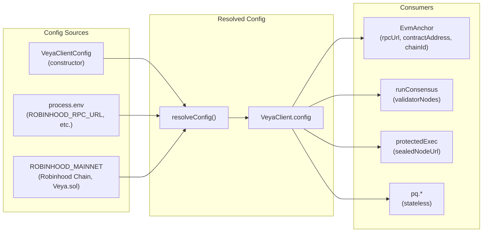
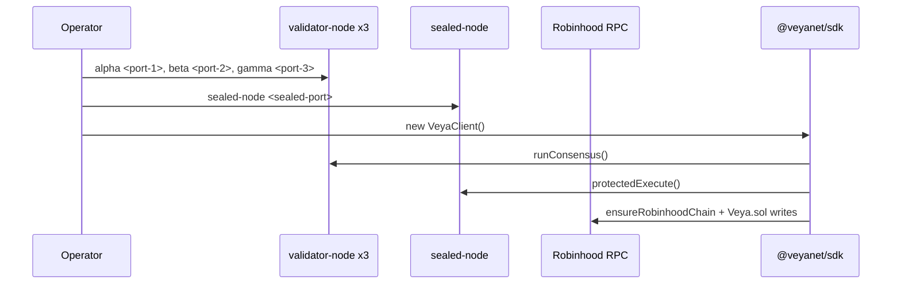

# SDK Configuration

**Configure `@veyanet/sdk` for post-quantum agent settlement on Robinhood Chain without a hosted API server.**

The default profile is **Mainnet**, contract `0x87dC582eEA544A434a5C1e30Ca3d12c1e548a674`. **Testnet** is optional: `network: "testnet"` or `ROBINHOOD_NETWORK=testnet`. The TypeScript SDK centralizes Robinhood Chain JSON-RPC, the deployed `Veya.sol` address, validator fleet URLs, and sealed-node endpoints. All configuration resolves through `resolveConfig()` with environment-variable fallbacks. Settlement is EVM: native units are wei, function names are camelCase, and the ABI is inlined in `src/abi` so the package does not depend on `@veyanet/program`.

---

## Table of Contents

1. [Purpose and Scope](#purpose-and-scope)
2. [Audience and Assumptions](#audience-and-assumptions)
3. [Glossary](#glossary)
4. [Configuration Architecture](#configuration-architecture)
5. [VeyaClientConfig](#veyaclientconfig)
6. [ResolvedVeyaConfig](#resolvedveyaconfig)
7. [resolveConfig](#resolveconfig)
8. [ROBINHOOD_TESTNET profile (optional)](#robinhood_testnet-profile-optional)
9. [VeyaClient Construction](#veyaclient-construction)
10. [Environment Variables](#environment-variables)
11. [Chain Selection](#chain-selection)
12. [Module Resolution Map](#module-resolution-map)
13. [ABI Inlining and Contract Address](#abi-inlining-and-contract-address)
14. [Local Development Stack](#local-development-stack)
15. [Production Patterns](#production-patterns)
16. [Security and Trust Boundaries](#security-and-trust-boundaries)
17. [Failure Modes and Recovery](#failure-modes-and-recovery)
18. [Performance and Scaling](#performance-and-scaling)
19. [Compatibility and Versioning](#compatibility-and-versioning)
20. [Troubleshooting](#troubleshooting)
21. [See Also](#see-also)

---

## Purpose and Scope

This document describes how `@veyanet/sdk` discovers Robinhood Chain endpoints, how constructor options override environment variables, and which modules consume each resolved field. Configuration is a local, deterministic merge. There is no remote configuration service on the critical path, and the SDK never fetches a program IDL at runtime.

The configuration surface is intentionally small. Cryptographic modules (`pq`, `memory`, `coordination`) do not require an RPC URL or a private key. Anchoring and on-chain writes require `payerPrivateKey`, `rpcUrl`, `contractAddress`, and `chainId`. Consensus and sealed execution require only HTTP origins for the operator-run node fleet.

The default profile is **Mainnet**. **Testnet** is `network: "testnet"` or `ROBINHOOD_NETWORK=testnet`. Contract addresses are in [NETWORK_PIN.md](../NETWORK_PIN.md). Validator and sealed nodes stay on loopback.

---

## Audience and Assumptions

Readers are expected to be comfortable with ethers v6 providers, EVM chain ids, and hex-encoded secp256k1 private keys. Familiarity with post-quantum primitives is useful but not required to configure the client. The document assumes Node.js 20 or later because the package `engines` field pins that floor.

The following assumptions are baked into defaults and should be treated as invariants unless an operator explicitly overrides them:

- Settlement happens on Robinhood Chain.
- `Veya.sol` is a protocol contract that stores environment, agent, and commitment state. It is not an ERC-20.
- Spending caps are denominated in wei (18 decimals for native ETH on Robinhood Chain).
- Contract function names in `INSTRUCTION_NAMES` are camelCase (`registerEnvironment`, not `register_environment`).
- The ABI lives in `src/abi` and is imported as JSON. There is no `@veyanet/program` dependency.

If any of those assumptions is violated at runtime, writes must fail closed. The `EvmAnchor.ensureRobinhoodChain()` gate exists specifically so a mis-pointed RPC cannot silently land transactions on another EVM.

---

## Glossary

| Term | Meaning in this SDK |
|------|---------------------|
| Robinhood Chain | EVM network used for VEYA settlement. Default profile is Mainnet. Testnet is explicit. |
| `Veya.sol` | Protocol contract storing environments, agents, attestations, commitments, spending, policy, nullifiers, and sealed chunks. |
| wei | Native currency subunit. One ETH is `10^18` wei. All on-chain spend amounts use wei. |
| `resolveConfig` | Pure merge of constructor options, `process.env`, and the Mainnet profile (`ROBINHOOD_MAINNET`). `ROBINHOOD_TESTNET` only when `network: "testnet"`. |
| `EvmAnchor` | Write client that submits real Robinhood Chain transactions through ethers. |
| `payerPrivateKey` | Hex secp256k1 key used as `msg.sender` for `Veya.sol` writes. |
| Validator nodes | HTTP processes that execute payloads and return BLAKE3 + ML-DSA attestations. |
| Sealed node | HTTP process that AES-256-GCM seals payloads and returns ciphertext commitments. |
| ABI inlining | `VEYA_ABI` compiled from `Veya.json` inside `src/abi`, not imported from another package. |

These terms appear throughout the remaining SDK module docs. When a later document says "the resolved config," it means the `ResolvedVeyaConfig` object produced by `resolveConfig`.

---

## Configuration Architecture

Configuration flows from an explicit `network` or constructor field, then `ROBINHOOD_NETWORK`, then the Mainnet profile. `ROBINHOOD_NETWORK=testnet` selects Testnet. No remote config service participates.



The PQ-first rule is that cryptographic modules do not require Robinhood Chain configuration. Only anchoring and on-chain flows need `payerPrivateKey` and `contractAddress`. Consensus and sealed execution need HTTP origins that the operator controls.

Precedence is left-to-right within each field: constructor wins, then environment, then the constant in `src/chain.ts`. Empty strings are not treated as missing values. If an operator passes `rpcUrl: ""`, the merge will keep the empty string rather than falling through to the default. Pass `undefined` (or omit the field) when the intent is to inherit.

---

## VeyaClientConfig

**File:** `src/config.ts`

```typescript
export type VeyaClientConfig = {
  /** EVM JSON-RPC endpoint. Mainnet unless network is testnet. */
  rpcUrl?: string;
  /** Deployed Veya.sol address. */
  contractAddress?: string;
  /** EVM chain id. Set only when overriding the selected profile. */
  chainId?: number;
  /** Block explorer origin (no trailing slash). */
  explorerUrl?: string;
  /** Payer private key as hex string (never commit real secrets). */
  payerPrivateKey?: string;
  /** Validator node URLs for 2-of-3 consensus. */
  validatorNodes?: string[];
  /** Sealed-node origin for protected execution. */
  sealedNodeUrl?: string;
};
```

Every field is optional at the type level. Requiredness is a runtime property of the operation being performed, not of the type. That distinction matters: a hashing-only process can construct `VeyaClient` with an empty object, while `registerPqOnchain()` will throw if no payer key is present.

### Field reference

| Field | Type | Required for | PQ relevance |
|-------|------|--------------|--------------|
| `rpcUrl` | `string` | On-chain txs, account reads | None: JSON-RPC only |
| `contractAddress` | `string` | `Veya.sol` writes and reads | Stores BLAKE3 hashes and ML-DSA sig bytes |
| `chainId` | `number` | `ensureRobinhoodChain()` | Guards against wrong-network writes |
| `explorerUrl` | `string` | Receipt deep links | None |
| `payerPrivateKey` | `string` | Transaction signing | Enables `registerPqOnchain()` |
| `validatorNodes` | `string[]` | `runConsensus()` | Nodes sign BLAKE3 digests with ML-DSA-44 |
| `sealedNodeUrl` | `string` | `protectedExecute()` | Sealed boundary uses AES-256-GCM + BLAKE3 |

`payerPrivateKey` is a hex string, typically `0x`-prefixed 32-byte secp256k1 material. A JSON byte-array key will not sign Robinhood Chain transactions.

`contractAddress` is a 20-byte EVM address. The testnet deployment is `0x1a1Dc3c55550FCE9F70ef6cDEeF967c0b72a5d84`. Checksums should be preserved when logging, but ethers accepts either mixed-case EIP-55 or lowercase.

---

## ResolvedVeyaConfig

After `resolveConfig`, every field except the payer key is a concrete string or number. The payer remains `string | undefined` because off-chain flows are first-class.

```typescript
export type ResolvedVeyaConfig = {
  rpcUrl: string;
  contractAddress: string;
  chainId: number;
  explorerUrl: string;
  payerPrivateKey: string | undefined;
  validatorNodes: string[];
  sealedNodeUrl: string;
};
```

`VeyaClient.config` is this resolved object. Downstream modules should read from `client.config` rather than re-parsing environment variables. Re-parsing would allow a later `process.env` mutation to diverge from the values the client was constructed with.

`chainId` is parsed with `Number(...)`. If `ROBINHOOD_CHAIN_ID` is set to a non-numeric string, the result is `NaN`. `EvmAnchor.ensureRobinhoodChain()` will then fail because `BigInt(NaN)` throws. That is the intended fail-closed behavior: a garbage chain id must not silently skip the network check.

---

## resolveConfig

`resolveConfig(config)` merges explicit options with environment variables and defaults. Call it directly when resolved values are needed without instantiating `VeyaClient`.

```typescript
import { resolveConfig } from "@veyanet/sdk";

const cfg = resolveConfig({
  validatorNodes: ["<validator-1-url>", "<validator-2-url>"],
});

console.log(cfg.network);       // mainnet
console.log(cfg.sealedNodeUrl); // <sealed-node-url>
console.log(cfg.contractAddress);
// Mainnet protocol contract. The address is in NETWORK_PIN.md.

const testnet = resolveConfig({ network: "testnet" });
console.log(testnet.network); // testnet
```

### Merge algorithm

For each field the function evaluates `config.<field> ?? process.env.<VAR> ?? DEFAULT`. The nullish coalescing operator means `0` is a valid `chainId` override (though it is never a correct Robinhood chain id) and an empty array is a valid `validatorNodes` override.

`validatorNodes` is the only array field. When taken from the environment it is split on commas:

```
VEYA_VALIDATOR_NODES=<validator-1-url>,<validator-2-url>,<validator-3-url>
```

Whitespace around URLs is not trimmed at config time. `runConsensus` trims each URL before issuing `fetch`, so `" <validator-1-url>"` still works at consensus time. Prefer clean comma-separated values anyway so logs and health checks match the live origins.

### Default values

| Key | Default | Override env var |
|-----|---------|------------------|
| `network` | `mainnet` | `ROBINHOOD_NETWORK=testnet` |
| `rpcUrl` | Mainnet RPC | `ROBINHOOD_MAINNET_RPC_URL` |
| `contractAddress` | Mainnet protocol contract | `VEYA_MAINNET_CONTRACT_ADDRESS` |
| `explorerUrl` | Mainnet explorer | `ROBINHOOD_MAINNET_EXPLORER_URL` |
| `validatorNodes` | `<validator-1-url>`, `<port-2>`, `<port-3>` | `VEYA_VALIDATOR_NODES` |
| `sealedNodeUrl` | `<sealed-node-url>` | `VEYA_SEALED_NODE_URL` |
| `payerPrivateKey` | `undefined` | `VEYA_MAINNET_RELAYER_PRIVATE_KEY` on Mainnet, `VEYA_DEPLOYER_PRIVATE_KEY` on Testnet |

There is no default payer. On-chain writes require an explicit key from the constructor or the environment. That is a security decision: a packaged default key would be public and useless on a funded account.

---

## ROBINHOOD_TESTNET profile (optional)

**File:** `src/chain.ts`

`ROBINHOOD_TESTNET` is the Testnet profile. The default client does not use it. `resolveConfig()` with no `network` returns Mainnet. Pass `network: "testnet"` to select the object below. Numeric pins are in [NETWORK_PIN.md](../NETWORK_PIN.md).

```typescript
export const ROBINHOOD_TESTNET_CHAIN_ID: number; // see src/chain.ts

export const ROBINHOOD_MAINNET = {
  chainId: ROBINHOOD_TESTNET_CHAIN_ID,
  chainIdHex: ROBINHOOD_MAINNET.chainIdHex,
  name: "Robinhood Chain Testnet",
  rpcUrl: "https://rpc.testnet.chain.robinhood.com",
  explorerUrl: "https://explorer.testnet.chain.robinhood.com",
  nativeCurrency: {
    name: "ETH",
    symbol: "ETH",
    decimals: 18,
  },
  contractAddress: "0x1a1Dc3c55550FCE9F70ef6cDEeF967c0b72a5d84",
} as const;
```

Helper functions live beside the constant:

| Function | Behavior |
|----------|----------|
| `explorerTxUrl(hash, base?)` | Builds `{explorer}/tx/0x...`, inserting `0x` if missing and stripping a trailing slash on the origin. |
| `explorerAddressUrl(address, base?)` | Builds `{explorer}/address/{address}`. |
| `isRobinhoodTestnet(chainId)` | Returns true iff `chainId` equals `ROBINHOOD_TESTNET_CHAIN_ID`. `isRobinhoodMainnet(chainId)` is the Mainnet check. |

Wallet connection flows that add Robinhood Chain to a browser wallet should use `chainIdHex: ROBINHOOD_MAINNET.chainIdHex` together with the RPC and explorer URLs above. The SDK itself does not call `wallet_addEthereumChain`; it talks JSON-RPC through ethers.

Native currency decimals are 18. Converting a human amount such as `0.01 ETH` to an on-chain spend uses `ethers.parseEther("0.01")`, which yields wei. Do not pass lamports, USDC atomic units, or floating-point numbers into `initSpendingLimit` or `recordSpend`.

---

## VeyaClient Construction

### Off-chain only (PQ, consensus, sealed)

No payer is required. This path is the default for local development and CI hashing tests.

```typescript
import { VeyaClient } from "@veyanet/sdk";

const client = new VeyaClient({
  validatorNodes: ["<validator-1-url>", "<validator-2-url>", "<validator-3-url>"],
  sealedNodeUrl: "<sealed-node-url>",
});

const { publicKey, privateKey } = await client.pqKeygen();
const fingerprint = await client.hashBlake3(publicKey);

const quorum = await client.runConsensus("task-1", { action: "ping" });

const sealed = await client.protectedExecute({
  environmentId: "env-uuid",
  agentId: "agent-uuid",
  eventType: "audit",
  payload: { step: "finalize" },
  sessionEntropy: crypto.getRandomValues(new Uint8Array(32)),
});
```

`client.evm` is `undefined` in this configuration. Calling `client.registerPqOnchain()` throws `payerPrivateKey required for on-chain ops on Robinhood Chain`.

### With EVM anchoring

`payerPrivateKey` enables `client.evm` (`EvmAnchor`). The constructor does not send a transaction. The first write calls `ensureRobinhoodChain()`, which issues `eth_chainId` against the configured RPC.

```typescript
import { VeyaClient } from "@veyanet/sdk";

const client = new VeyaClient({
  payerPrivateKey: process.env.VEYA_DEPLOYER_PRIVATE_KEY,
  rpcUrl: process.env.ROBINHOOD_MAINNET_RPC_URL,
  contractAddress: process.env.VEYA_CONTRACT_ADDRESS,
  chainId: ROBINHOOD_MAINNET.chainId,
});

const { publicKeyHash, environmentTx, memoTx, explorer } =
  await client.registerPqOnchain(1);
// envType: 0=Execution, 1=SecureEnclave, 2=Governance
```

`envType` values match `Veya.sol` `EnvironmentType`. Passing `3` or higher reverts with `InvalidEnvironmentType`.

### Lazy EvmAnchor

`EvmAnchor` is constructed only when a private key is present on the constructor argument or the resolved config:

```typescript
if (client.evm) {
  const tx = await client.evm.anchorMemo(
    environmentUuid,
    "e222a4812bace5608fd743318c2cb0f05cd8de4196f8cf09ffa195734c99d2a0",
  );
  console.log(client.explorerFor(tx));
  // https://explorer.testnet.chain.robinhood.com/tx/0x...
}
```

The wallet is an `ethers.Wallet` bound to `ethers.JsonRpcProvider`. The provider is intentionally not constructed with `staticNetwork`, so `getNetwork()` must query `eth_chainId`. A mis-pointed RPC cannot claim to be Robinhood Chain by static configuration alone.

---

## Environment Variables

| Variable | Maps to | Example | Notes |
|----------|---------|---------|-------|
| `ROBINHOOD_RPC_URL` | `rpcUrl` | `https://rpc.testnet.chain.robinhood.com` | Dedicated RPC recommended for production |
| `ROBINHOOD_CHAIN_ID` | `chainId` | Testnet profile (Mainnet uses `ROBINHOOD_MAINNET_CHAIN_ID`) | Parsed with `Number(...)` |
| `ROBINHOOD_EXPLORER_URL` | `explorerUrl` | `https://explorer.testnet.chain.robinhood.com` | No trailing slash |
| `VEYA_CONTRACT_ADDRESS` | `contractAddress` | `0x1a1Dc3c55550FCE9F70ef6cDEeF967c0b72a5d84` | Pin per deployment |
| `VEYA_VALIDATOR_NODES` | `validatorNodes` | `http://a:<port-1>,http://b:<port-2>,http://c:<port-3>` | Comma-separated |
| `VEYA_SEALED_NODE_URL` | `sealedNodeUrl` | `<sealed-node-url>` | TLS URL in production |
| `VEYA_DEPLOYER_PRIVATE_KEY` | `payerPrivateKey` | `0xabc...` 32-byte hex | Never commit |

### Shell export examples

```bash
# Bash / zsh
export ROBINHOOD_MAINNET_RPC_URL="https://rpc.mainnet.chain.robinhood.com"


export VEYA_VALIDATOR_NODES="<validator-1-url>,<validator-2-url>,<validator-3-url>"
export VEYA_SEALED_NODE_URL="<sealed-node-url>"
```

```powershell
# PowerShell
$env:ROBINHOOD_RPC_URL = "https://rpc.testnet.chain.robinhood.com"

$env:VEYA_VALIDATOR_NODES = "<validator-1-url>,<validator-2-url>,<validator-3-url>"
```

Keep `VEYA_DEPLOYER_PRIVATE_KEY` out of shell history where possible. Prefer a secrets manager, a mounted file that the process reads once, or an ephemeral injection at container start.

---

## Chain Selection

The default is Mainnet. Pass `network: "testnet"` for Testnet. Numeric ids are in [NETWORK_PIN.md](../NETWORK_PIN.md).

| Profile | How to select | `Veya.sol` |
|---------|---------------|------------|
| Mainnet | Omit `network` | `0x87dC582eEA544A434a5C1e30Ca3d12c1e548a674` |
| Testnet (optional) | `network: "testnet"` or `ROBINHOOD_NETWORK=testnet` | `0x1a1Dc3c55550FCE9F70ef6cDEeF967c0b72a5d84` |

`EvmAnchor.ensureRobinhoodChain()` compares the RPC chain id with the selected profile. A mismatch throws before a transaction is sent. The numeric ids are in [NETWORK_PIN.md](../NETWORK_PIN.md).

The check is cached on the instance after the first success (`networkChecked = true`). Construct a new `EvmAnchor` if the RPC URL changes at runtime; do not mutate `provider` in place.

A wallet on another EVM fails the first write when the RPC does not match the selected profile. That is correct. The SDK is not a multi-chain router. Mainnet and Testnet are the two profiles.

---

## Module Resolution Map

| SDK export | Config dependency | Crypto primitives |
|------------|-------------------|-------------------|
| `VeyaClient.pqKeygen()` | None | ML-DSA-44 (`@noble/post-quantum`) |
| `VeyaClient.hashBlake3()` | None | BLAKE3-256 (`hash-wasm`) |
| `VeyaClient.runConsensus()` | `validatorNodes` | BLAKE3 + ML-DSA (node-side) |
| `VeyaClient.protectedExecute()` | `sealedNodeUrl` | AES-256-GCM + BLAKE3 |
| `VeyaClient.registerPqOnchain()` | `payerPrivateKey`, `rpcUrl`, `contractAddress`, `chainId` | ML-DSA + BLAKE3 |
| `pq.generateKyberKeys()` | None | Kyber-768 / ML-KEM-768 |
| `routeMessage()` | None (in-process policy map) | Optional Kyber session |
| `storeMemory()` | None | BLAKE3 content hash, file at `~/.veya/agent-memory.json` |
| `PolicyAgent` | None at construct time | `maxWeiPerAction` is wei, not lamports |

Import paths:

```typescript
import { VeyaClient, resolveConfig, pq, EvmAnchor } from "@veyanet/sdk";
import { runConsensus } from "@veyanet/sdk";
import { protectedExec } from "@veyanet/sdk";
import { ROBINHOOD_MAINNET, INSTRUCTION_NAMES } from "@veyanet/sdk";
```

`INSTRUCTION_NAMES` is a camelCase catalog of `Veya.sol` write functions. Tests assert that `register_environment` is not present. Use these names when logging, when matching ABI entries, and when documenting operator playbooks.

---

## ABI Inlining and Contract Address

**File:** `src/abi/index.ts`

```typescript
import artifact from "./Veya.json" with { type: "json" };

export const VEYA_ABI = artifact.abi as InterfaceAbi;
export const VEYA_BYTECODE = artifact.bytecode as string;
export const VEYA_CONTRACT_ADDRESS =
  "0x1a1Dc3c55550FCE9F70ef6cDEeF967c0b72a5d84";
```

The ABI is vendored into this package as `src/abi/Veya.json`. Keep that JSON in lockstep with the deployed `Veya.sol` bytecode. Because there is no separate program package, changing the contract without regenerating this JSON will produce ethers encoding that does not match the deployed bytecode.

`EvmAnchor` constructs `new ethers.Contract(resolved.contractAddress, VEYA_ABI, this.wallet)`. A wrong `contractAddress` that still has code will revert on selector mismatch. A wrong address with no code will fail at estimate/gas. Both are preferable to silently writing to an unrelated contract.

`VEYA_BYTECODE` is exported for deploy scripts. Runtime anchoring does not redeploy. Production clients should pin `VEYA_CONTRACT_ADDRESS` and refuse to start if the configured address does not match the expected deployment.

---

## Local Development Stack

Typical gitignored local env:

```env
ROBINHOOD_MAINNET_RPC_URL=https://rpc.mainnet.chain.robinhood.com

ROBINHOOD_EXPLORER_URL=https://explorer.testnet.chain.robinhood.com

VEYA_VALIDATOR_NODES=<validator-1-url>,<validator-2-url>,<validator-3-url>
VEYA_SEALED_NODE_URL=<sealed-node-url>
```

### Startup order



1. Start the validator fleet: see [operations/consensus-cluster.md](../operations/consensus-cluster.md).
2. Start sealed-node: see [operations/sealed-node.md](../operations/sealed-node.md).
3. Confirm the payer has ETH for gas (wei-denominated).
4. Run SDK tests: `npm install && npm test`.

Local nodes never replace chain id checks. Even when validators run on loopback, `EvmAnchor` still queries `eth_chainId` before the first `Veya.sol` write.

---

## Production Patterns

### Ephemeral payer injection

```typescript
import { readFileSync } from "node:fs";
import { VeyaClient } from "@veyanet/sdk";

const payerPrivateKey = readFileSync("/run/secrets/deployer.key", "utf8").trim();
const client = new VeyaClient({
  payerPrivateKey,
  rpcUrl: process.env.ROBINHOOD_MAINNET_RPC_URL,
  contractAddress: process.env.VEYA_CONTRACT_ADDRESS,
  chainId: Number(process.env.ROBINHOOD_MAINNET_CHAIN_ID ?? ROBINHOOD_MAINNET.chainId),
});
```

Do not log the key. If a process dump is required, redact `payerPrivateKey` and any RPC URLs that embed credentials.

### Multi-environment config

| Environment | `rpcUrl` | `chainId` | `contractAddress` | Nodes |
|-------------|----------|-----------|-------------------|-------|
| local nodes + testnet settlement | public testnet RPC | Testnet profile | published `Veya.sol` | private validator URLs, <sealed-port> |
| staging | dedicated testnet RPC | Testnet profile | staging deploy if different | 3 VMs on a private NIC |
| production | dedicated RPC | pinned production chain id | the deployed `Veya.sol` | 5 validators, threshold still 2 unless the client is changed |

Never share `payerPrivateKey` across environments. Rotate on compromise. Spending caps (`PolicyAgentConfig.maxWeiPerAction` and `initSpendingLimit`) must be re-derived in wei for each environment; copying a lamport figure from another stack will under- or over-constrain treasury agents by many orders of magnitude.

### Config validation helper

```typescript
import { resolveConfig, isRobinhoodTestnet } from "@veyanet/sdk";

function assertAnchoringReady() {
  const cfg = resolveConfig();
  if (!cfg.payerPrivateKey) throw new Error("payerPrivateKey required");
  if (!isRobinhoodTestnet(cfg.chainId) && cfg.chainId !== expectedProductionChainId) {
    throw new Error(`unexpected chain id ${cfg.chainId}`);
  }
  if (cfg.contractAddress.toLowerCase() !== expectedAddress.toLowerCase()) {
    throw new Error("contractAddress does not match pinned Veya.sol");
  }
}
```

---

## Security and Trust Boundaries

| Risk | Mitigation |
|------|------------|
| Committed private keys | Gitignore secrets; never commit `.env` with `VEYA_DEPLOYER_PRIVATE_KEY` |
| Env leakage in logs | Redact `payerPrivateKey` and RPC API keys |
| Public validator ports | Bind private NIC; TLS reverse proxy |
| Stale contract address | Pin `VEYA_CONTRACT_ADDRESS` per deployment |
| Wrong-network writes | `ensureRobinhoodChain()` queries `eth_chainId` |
| Classical crypto drift | SDK uses ML-DSA-44 + BLAKE3 + Kyber-768; no SHA-256 on new paths |
| Unit confusion | Spend amounts are wei; `maxWeiPerAction` is the policy field name |

Load secrets from HSM, vault, or ephemeral env injection. Restrict file permissions on key files (`chmod 600` on Unix, ACL lockdown on Windows). PQ verification remains off-chain: configuration does not change that split. `Veya.sol` stores hashes and signature bytes; auditors verify ML-DSA using `@veyanet/sdk/pq`.

The JSON-RPC endpoint is a trust boundary. A malicious RPC can lie about receipts, gas, and logs. It cannot change `eth_chainId` without failing `ensureRobinhoodChain` if the operator configured the expected id, but it can still withhold transactions. Use an RPC the operator controls or a provider with a documented SLA.

Validator and sealed nodes are also trust boundaries. They see plaintext payloads (sealed-node after key derivation) or execution inputs (validators). Network isolation matters as much as cryptographic choices. Configuration cannot compensate for a public `<sealed-port>` bind on a shared host.

---

## Failure Modes and Recovery

| Failure | Detection | Recovery |
|---------|-----------|----------|
| RPC returns a different chain id | `ensureRobinhoodChain` throws | Fix `ROBINHOOD_RPC_URL` or `chainId`; reconstruct the client |
| RPC unreachable | ethers network error on first write or read | Retry with backoff; switch provider; do not disable the chain check |
| Missing payer | `registerPqOnchain` throws | Inject `payerPrivateKey`; keep off-chain methods available |
| Empty `validatorNodes` | `runConsensus` returns no results, `consensus_reached: false` | Restore the three default origins or a production fleet |
| Comma-split produced one URL | Env missing commas | Use `http://a:<port-1>,http://b:<port-2>,http://c:<port-3>` |
| `chainId` is `NaN` | `BigInt(NaN)` throws inside the chain gate | Set a numeric `ROBINHOOD_CHAIN_ID` |
| ABI drift vs deployed `Veya.sol` | Revert on unknown selector | Regen `src/abi/Veya.json` from the deployed compiler artifact |
| Spend configured in lamports | Immediate over-cap or under-cap vs wei intent | Convert with `ethers.parseEther`; use `maxWeiPerAction` |
| Explorer origin has a trailing slash | Duplicate slash in URLs if helpers were bypassed | `explorerTxUrl` already strips trailing slashes |

`networkChecked` is per `EvmAnchor` instance. After a successful check, a later RPC hijack on the same provider object would not be re-validated. Recreate the client when rotating RPC URLs.

Failed consensus does not roll back anything on-chain because consensus is off-chain. Failed sealed execution similarly leaves no chain residue unless the operator later calls `storeSealedState`. Treat HTTP failures as local and retry with the same `task_id` only when the payload is idempotent.

---

## Performance and Scaling

`resolveConfig` is synchronous and cheap. It may be called per request, but constructing `EvmAnchor` creates a provider and a wallet, so prefer one client per process.

`ensureRobinhoodChain` costs one `eth_chainId` round trip per process (first write). Subsequent writes reuse the cached flag.

`runConsensus` currently queries validator nodes sequentially. Latency is the sum of node round trips, not the max. For a 3-node fleet on loopback this is negligible. For geographically distributed nodes, expect hundreds of milliseconds to a few seconds. The threshold remains 2 matching BLAKE3 hashes regardless of fleet size; extra nodes improve availability, not the numeric threshold, unless `consensus.ts` is changed.

JSON-RPC batching is not used. Each `Veya.sol` write is a single transaction that waits for mining via `tx.wait()`. Configure ethers polling if the RPC's default interval is too slow for the operator's confirmation SLA.

---

## Compatibility and Versioning

`@veyanet/sdk` version `1.2.9` targets Node.js 20+, ethers 6, `@noble/post-quantum` ML-DSA-44 and ML-KEM-768, and `hash-wasm` BLAKE3. The inlined ABI matches `Veya.sol` on Mainnet and on Testnet. The package version in this tree is not a new npm publish.

Instruction names are a compatibility contract. Consumers should import `INSTRUCTION_NAMES` rather than hard-coding snake_case names from other stacks. Adding a Solidity function requires updating `src/abi/Veya.json`, `INSTRUCTION_NAMES`, and `EvmAnchor` together.

Environment variable names listed in this document are the names this package reads.

---

## Troubleshooting

| Symptom | Likely cause | Fix |
|---------|--------------|-----|
| `payerPrivateKey required for on-chain ops on Robinhood Chain` | No payer in config | Pass `payerPrivateKey` or use off-chain methods only |
| `VEYA SDK expected chain id …` | RPC is not the selected Robinhood Chain network | Point the RPC at `rpc.mainnet.chain.robinhood.com` (Mainnet) or `rpc.testnet.chain.robinhood.com` (Testnet) |
| `fetch failed` on consensus | Validator nodes not running | Start `validator-node` on their configured ports |
| `sealed-node error: 500` | sealed-node not started | Bind sealed-node on `<sealed-port>` |
| Revert on first write | Wrong `contractAddress` or ABI drift | Pin `0x1a1Dc3c55550FCE9F70ef6cDEeF967c0b72a5d84` and refresh `src/abi` |
| Rate limit / 429 on RPC | Public endpoint saturation | Use a dedicated Robinhood Chain RPC |
| `validatorNodes` has one URL | Env parse error | Comma-separate without quoting issues |
| Spend reverts `SpendingLimitExceeded` | Amount not in wei, or cap too low | Use wei; `PolicyAgentConfig.maxWeiPerAction` |
| Explorer link 404 | Wrong explorer origin or missing `0x` | Use `explorerTxUrl` from `src/chain.ts` |
| Wallet cannot parse key | JSON byte array passed as payer | Use hex secp256k1 |

### Diagnostic script

```typescript
import { resolveConfig, ROBINHOOD_MAINNET, isRobinhoodTestnet } from "@veyanet/sdk";

const cfg = resolveConfig();
console.table({
  rpcUrl: cfg.rpcUrl,
  chainId: cfg.chainId,
  isTestnet: isRobinhoodTestnet(cfg.chainId),
  contract: cfg.contractAddress,
  explorer: cfg.explorerUrl,
  validators: cfg.validatorNodes.length,
  sealed: cfg.sealedNodeUrl,
  hasPayer: Boolean(cfg.payerPrivateKey),
  defaultContract: ROBINHOOD_MAINNET.contractAddress,
});
```

If `isTestnet` is false while the operator intended testnet, stop before sending a transaction. If `contract` does not match `defaultContract` and that was not intentional, stop as well.

---

## See Also

- [pq-crypto.md](./pq-crypto.md): ML-DSA-44, Kyber-768, BLAKE3 primitives
- [evm-anchoring.md](./evm-anchoring.md): `EvmAnchor` and on-chain flows
- [decentralized-compute.md](./decentralized-compute.md): `runConsensus()` client
- [sealed-execution.md](./sealed-execution.md): `protectedExec()` client
- [coordination.md](./coordination.md): MCP routing and `maxWeiPerAction`
- [memory.md](./memory.md): local store and on-chain nullifiers
- [operations/consensus-cluster.md](../operations/consensus-cluster.md): validator fleet
- [operations/sealed-node.md](../operations/sealed-node.md): sealed-node runbook
